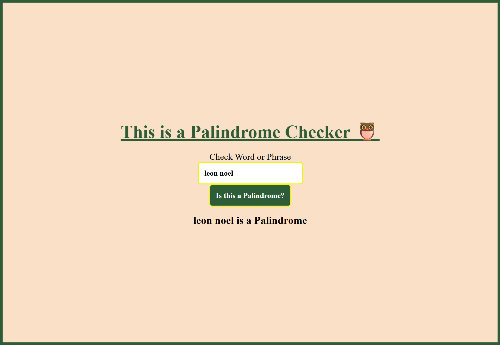

# 🦉 Palindrome Checker

## Project Description

A simple palindrome checker where users can check if a word or phrase is a palindrome.
## Tech Stack

- **HTML** 
- **CSS**
- **JavaScript**
- **Node.js**

## How to Run or View It Locally

1. Clone or download the repository.
2. Install the dependancies with `npm install`
3. Start the server using `node server.js`
4. Open local development server 8000.

## Screenshots and Demo
Live link: https://server-side-palindrome-checker.onrender.com/

### Application Interface

The interface displays a input for user to add their word or phrase. A button to check the input. Answer will display beneath.  